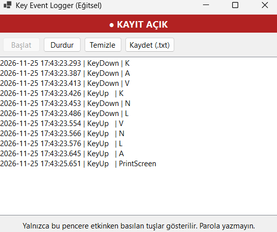
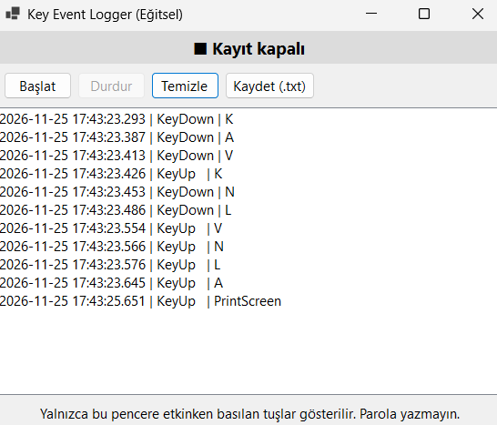

# YMH219 - Key Event Logger (Eğitsel)

Nesne Tabanlı Programlama (YMH 219) dersi için klavye olaylarının nasıl yakalandığını gösteren Windows Forms uygulaması.

**Öğrenci:** Muhammed Metin Kızıl
**Öğrenci No:** 250541038

## Kullanılan Teknolojiler

- C# / .NET 8, Windows Forms
- Ek NuGet paketi kullanılmamıştır

## Kurulum ve Çalıştırma

Gereksinim: Windows ve .NET 8 SDK (veya .NET masaüstü geliştirme yükü kurulu Visual Studio 2022).

```bash
dotnet run
```

Visual Studio ile: `YMH219-KeyEventLogger.csproj` dosyasını açıp F5'e bas.

## Temel Özellikler

- **Başlat / Durdur** ile kayıt kontrolü ve belirgin durum göstergesi
- `KeyDown` ve `KeyUp` olaylarını tuş adı ve zaman bilgisiyle listeleme
- **Temizle** ile kayıtları silme
- Toplam tuş sayısı ve en sık basılan 5 tuşu anlık gösterme
- **Kaydet** ile kayıtları `.txt` dosyasına yazma, dosya hatalarını bildirme

## Güvenlik Sınırı

Bu uygulama sistem genelinde çalışan bir keylogger değildir. Yalnızca kendi penceresi etkinken oluşan olayları görür. Global klavye kancası, arka planda veya açılışta otomatik çalışma ve ağ üzerinden veri gönderme yoktur. Dosyaya yalnızca kullanıcı isterse yazılır.

## Sınıf Yapısı

| Sınıf | Görevi |
|---|---|
| `KeyLogEntry` | Tek bir tuş olayının verisi ve metin biçimi |
| `KeyLog` | Kayıt durumu, olay listesi ve dosyaya yazma |
| `KeyStatistics` | Toplam ve en sık basılan tuşları hesaplama |
| `LoggerForm` | Arayüz ve klavye olayları |

## Ekran Görüntüleri

**Kayıt açıkken**



**Kayıt kapalıyken**



## Bilinen Sınırlamalar

- Windows'un kendisinin işlediği bazı kısayollar (ör. Windows tuşu birleşimleri) görünmeyebilir.
- Tuş adları .NET `Keys` değerleri olarak gösterilir.
- Basılı tutulan tuş birden fazla `KeyDown` kaydı üretir ve istatistikte her biri sayılır.
- Kayıt açıkken Tab ve ok tuşları arayüzde gezinmek için kullanılamaz.
